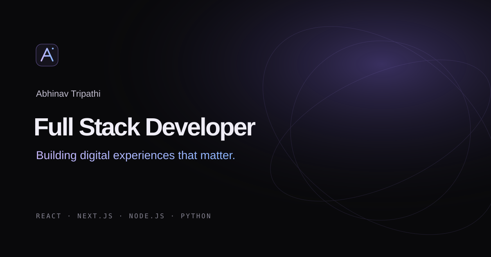

# Abhinav Tripathi — Developer Portfolio

This is my personal developer portfolio, where I showcase the projects I've built, the technologies I work with, and my journey as a Full Stack Developer.

I built this portfolio with a dark editorial-style design, responsive layouts, smooth animations, and a clean interface. My goal was to create something that looks good, feels smooth, and works well across different screen sizes.

**Live Website:** [abhinavtripathi.is-a.dev](http://abhinavtripathi.is-a.dev/)

## Preview

Here is a preview of my portfolio website.



## Tech Stack

These are the technologies and libraries I used to build this project:

- **Frontend:** React 19
- **Language:** JavaScript (ES Modules)
- **Build Tool:** Vite 6
- **Styling:** Tailwind CSS v4
- **Animations:** Framer Motion 12
- **Icons:** Lucide React and React Icons

## Features

- Responsive layout for mobile, tablet, and desktop
- Dark and light theme toggle
- Smooth animations and section transitions
- Project showcase with custom CSS-built previews
- Skills and technology section
- Resume download
- Contact form with email integration
- Custom navigation, logo, and favicon

## Getting Started

If you want to run this project locally, follow these steps.

### 1. Clone the repository

```bash
git clone https://github.com/abhinavtee/developer-portfolio.git
```

### 2. Navigate to the project folder

```bash
cd developer-portfolio
```

### 3. Install dependencies

```bash
npm install
```

### 4. Start the development server

```bash
npm run dev
```

Open the local URL provided by Vite, usually `http://localhost:5173`.

## Build for Production

To create an optimized production build, run:

```bash
npm run build
```

To preview the production build locally:

```bash
npm run preview
```

The generated production files are stored in the `dist` directory.

## Project Structure

```text
developer-portfolio/
├── public/
│   ├── abhinav.jpg
│   ├── Abhinav-Tripathi-Resume.pdf
│   ├── favicon.svg
│   ├── favicon-32.png
│   ├── apple-touch-icon.png
│   └── og-cover.svg
├── src/
│   ├── components/
│   │   ├── BrandMark.jsx
│   │   ├── Navbar.jsx
│   │   ├── ProjectCard.jsx
│   │   ├── ProjectVisual.jsx
│   │   ├── Reveal.jsx
│   │   └── SectionHeading.jsx
│   ├── data/
│   │   └── portfolio.js
│   ├── App.jsx
│   ├── index.css
│   └── main.jsx
├── index.html
├── package.json
├── vite.config.js
└── README.md
```

## Deployment

The website is deployed through Vercel and connected to this GitHub repository.

**Live URL:** [abhinavtripathi.is-a.dev](http://abhinavtripathi.is-a.dev/)

## About Me

I'm Abhinav, a Full Stack Developer interested in building modern web applications and continuously improving my development skills.

I enjoy exploring new technologies, solving problems, and turning ideas into functional applications.

## Connect With Me

- **GitHub:** [abhinavtee](https://github.com/abhinavtee)
- **LinkedIn:** [Abhinav Tripathi](https://www.linkedin.com/in/abhinavte/)
- **Portfolio:** [abhinavtripathi.is-a.dev](http://abhinavtripathi.is-a.dev/)

---

Thanks for checking out my project!